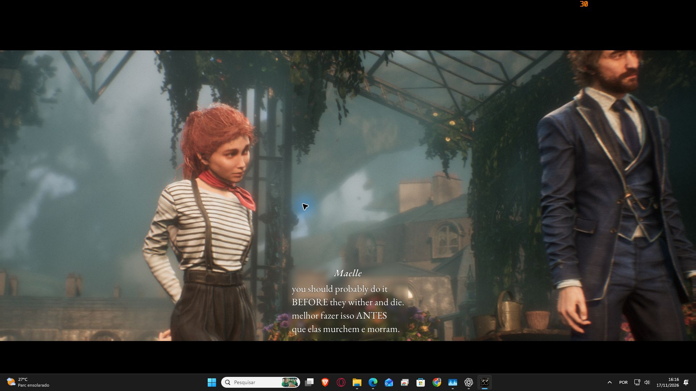

# Clair Obscur — diálogos em inglês + português

Mod para estudar inglês jogando **Clair Obscur: Expedition 33**: o texto oficial em inglês aparece acima da tradução oficial em português brasileiro, nas legendas de diálogo identificadas.

**6.947 falas bilíngues**, com os menus e as opções de resposta preservados em português. O áudio e o tempo de exibição seguem o jogo. Não há tradução automática, conexão com serviços de tradução ou destaque por palavra.



## Download

Baixe **[ClairObscur-Dialogos-EN-PTBR-v1.0.0.zip](https://github.com/VictorHSalvador/clair-obscur-dialogos-en-ptbr/releases/download/v1.0.0/ClairObscur-Dialogos-EN-PTBR-v1.0.0.zip)** na [página de versões](https://github.com/VictorHSalvador/clair-obscur-dialogos-en-ptbr/releases/latest).

Use o pacote da versão. O botão **Code → Download ZIP** baixa os scripts e a documentação, sem o arquivo `.pak` necessário para jogar.

## Antes de instalar

- É necessário ter o jogo instalado no Windows e acesso de escrita à pasta do jogo.
- O pacote foi construído e aberto em uma instalação identificada como **v1.5.2**. Outras atualizações e lojas não foram verificadas.
- Este pacote não atende às versões de console nem a sessões de jogo em nuvem.
- Feche o jogo antes de instalar, ativar ou desativar o mod.

## Instalação com o assistente

1. Baixe o ZIP da versão e **extraia a pasta inteira**. Não execute os arquivos de dentro do ZIP.
2. Abra **`Ativar-legendas.cmd`**.
3. Na primeira execução, selecione a **pasta do jogo que contém a pasta `Sandfall`**. Não selecione a própria pasta `Sandfall`. No Steam, use a opção de procurar os arquivos instalados do jogo para localizar essa pasta.
4. Aguarde a mensagem **“Legendas bilingues instaladas e ativadas.”**. A pasta escolhida será lembrada em `config.local.json`, somente no seu computador.
5. Abra o jogo e configure:
   - **Idioma dos textos:** Português (Brasil).
   - **Idioma das dublagens:** English.
   - **Legendas:** ativadas.
   - **Tamanho da legenda:** comece com o menor tamanho disponível.
6. Entre em uma cena ou conversa. O **inglês fica acima** e o **português abaixo**.

O instalador verifica o hash do mod, valida a estrutura da pasta selecionada e interrompe a operação se encontrar outro arquivo com o mesmo nome e conteúdo diferente. Ele não substitui os arquivos originais do jogo nem altera saves ou configurações do jogo.

## Instalação manual

1. Com o jogo fechado, abra `Sandfall/Content/Paks` na pasta de instalação.
2. Crie uma pasta chamada **`~mods`**, caso ela ainda não exista.
3. Copie **`zzz_ClairObscur_EN_PT_Dialogos_P.pak`** para essa pasta.

Estrutura esperada:

```text
Pasta do jogo/
└── Sandfall/
    └── Content/
        └── Paks/
            └── ~mods/
                └── zzz_ClairObscur_EN_PT_Dialogos_P.pak
```

Depois, use os mesmos ajustes de idioma descritos acima. **Não instale duas cópias do mod em pastas diferentes.**

## Desativar, reativar ou remover

- **Desativar:** feche o jogo e abra `Desativar-legendas.cmd`. O arquivo do mod será renomeado com o sufixo `.desativado`; ao reabrir o jogo, as legendas originais voltam a ser usadas.
- **Reativar:** com o jogo fechado, abra `Ativar-legendas.cmd`.
- **Remover manualmente:** com o jogo fechado, remova apenas o arquivo deste mod de `~mods` (ou sua cópia com o sufixo `.desativado`).
- **Escolher outra instalação:** remova `config.local.json` da pasta extraída e abra o assistente novamente, ou forneça `-PastaJogo` pelo PowerShell.

Exemplos opcionais para PowerShell, executados na pasta extraída:

```powershell
& '.\Controle-Legendas.ps1' -Acao Ativar -PastaJogo 'D:\Jogos\Expedition 33'
& '.\Controle-Legendas.ps1' -Acao Status -PastaJogo 'D:\Jogos\Expedition 33'
& '.\Controle-Legendas.ps1' -Acao Desativar -PastaJogo 'D:\Jogos\Expedition 33'
```

## Limites conhecidos

- Os dois idiomas usam a posição e a tipografia nativas. A legenda de cada idioma pode ocupar mais de uma linha; esta versão não usa uma fonte menor só para o português.
- Não há destaque nem sincronização palavra por palavra.
- **188 chaves compartilhadas entre falas e outros usos permanecem em português**, incluindo algumas opções de resposta e suas falas correspondentes. Registros sem um par oficial nos dois idiomas também não são modificados.
- O jogo inteiro não foi percorrido. A apresentação foi conferida no prólogo, inclusive em uma legenda de quatro linhas sem sobreposição na amostra. A versão final abriu e carregou uma cópia de um save existente; a conferência visual de uma conversa interativa não foi concluída.
- Falas longas podem ocupar mais espaço. Não há garantia de que todas as cenas terão a mesma área livre de imagem.
- Outros mods que substituam o mesmo recurso de localização podem entrar em conflito. Após atualizar o jogo, verifique a compatibilidade antes de reativar este pacote.

## Solução de problemas

| Problema | O que conferir |
|---|---|
| As legendas continuam só em português | Reinicie o jogo; confira o idioma dos textos e o caminho completo dentro de `Paks/~mods`; verifique se o arquivo não termina em `.desativado`. Algumas falas permanecem em português por projeto. |
| Tudo aparece só em inglês | Selecione **Português (Brasil)** como idioma dos textos. |
| A pasta selecionada é recusada | Escolha a pasta que contém `Sandfall`, um nível acima dela. |
| O assistente informa que o jogo está aberto | Feche o jogo e tente novamente. |
| O hash é diferente | Extraia novamente o pacote da versão. O assistente não sobrescreve um arquivo divergente. |
| O texto ocupa espaço demais | Reduza o tamanho da legenda nas configurações; falas longas ainda podem ocupar várias linhas. |
| O mod parou após uma atualização | Desative-o e confira as versões e os problemas relatados neste repositório. |

## Integridade do arquivo

SHA256 de `zzz_ClairObscur_EN_PT_Dialogos_P.pak`:

```text
3c0a60c89f26f963c0c62536b05f5bc8041e7999e152cdec1b0e7d15428bdf56
```

## Código e reprodução

- [`src/`](src): construção, classificação conservadora das falas e verificação independente.
- [`data/`](data): listas de inclusão e exclusão desta versão.
- [Como reproduzir o pacote](docs/REPRODUZIR.md): ferramentas e comandos. Os relatórios técnicos contêm nomes internos de cenas e podem revelar a história.
- [Créditos](CREDITS.md): ferramentas e referência da abordagem bilíngue.

Este é um mod pessoal e não oficial. Os textos e recursos do jogo pertencem aos respectivos titulares; o projeto não tem vínculo com Sandfall Interactive ou Kepler Interactive.
